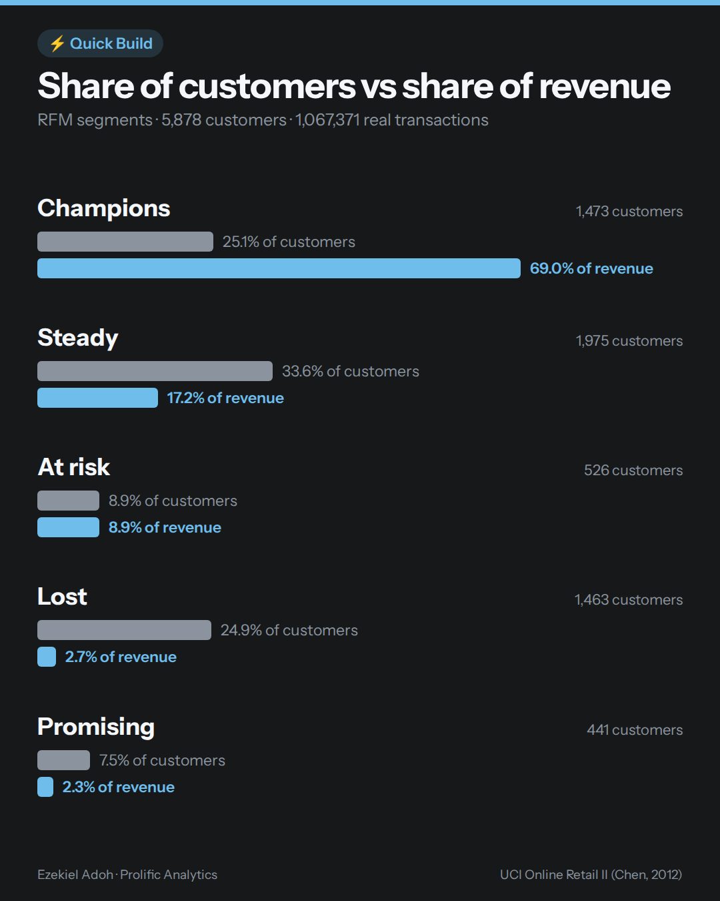

# RFM customer segmentation on 1M real transactions

One Python script that turns a raw order export into customer segments you can act on — run on 1,067,371 real transactions from a UK online gift retailer.



## Result

Across 5,878 customers after cleaning:

| Segment | Customers | % of customers | % of revenue |
|---|---|---|---|
| Champions | 1,473 | 25.1% | 69.0% |
| Steady | 1,975 | 33.6% | 17.2% |
| At risk | 526 | 8.9% | 8.9% |
| Lost | 1,463 | 24.9% | 2.7% |
| Promising | 441 | 7.5% | 2.3% |

**A quarter of customers drove 69% of two years of revenue.** Many of this retailer's customers are wholesalers, so a typical shop's mix will look different — which is the point of running it on your own data.

## What it does

`orders → clean → recency, frequency, spend per customer → score 1–5 → name the segments → table + chart`

1. **Load** every sheet of the Excel export and cache it as Parquet (first run ~1 minute, then ~2 seconds).
2. **Clean**, counting every row removed: exact duplicates (34,335), no customer ID (235,151 — 22% of the file), cancelled invoices (18,390), zero or negative quantity/price (70).
3. **RFM per customer**: days since last order, number of distinct invoices, total revenue.
4. **Score** each measure 1–5 by fifths (ranked first, so ties don't break the bins).
5. **Segment** with five plain-English rules: Champions, At risk, Promising, Lost, Steady.

## Quick Build #2 — the churn-rhythm column

`rhythm.py`: for each customer, days since last order ÷ their median gap between orders. Above 2 means drifting.
1,397 of 5,878 customers (23.8%) were drifting, holding 25.7% of revenue. Run: `uv run python rhythm.py`

## Run it

Requires [uv](https://docs.astral.sh/uv/).

```bash
git clone https://github.com/PHzeek/rfm-quick-build.git
cd rfm-quick-build
uv sync
```

Download **Online Retail II** from the [UCI Machine Learning Repository](https://archive.ics.uci.edu/dataset/502/online+retail+ii), unzip it, and save the Excel file as `data/online_retail_II.xlsx`. Then:

```bash
uv run python rfm.py
```

## Lessons from real data

- **Mixed types in one column.** Most invoice numbers are numbers, but cancellations are text (`C489449`) — and a few product descriptions are numbers. Parquet needs one type per column, so text columns are converted up front.
- **Count invoices, not rows.** One order has many product lines.
- **Sum revenue, not price.** A bug that raises no error — caught by dividing total spend by order lines and getting a unit price.
- **Rank before binning.** At least a quarter of customers bought exactly once; tied values can't be split into fifths.

## Data

Chen, D. (2012). *Online Retail II* [Dataset]. UCI Machine Learning Repository. https://doi.org/10.24432/C5CG6D — licensed CC BY 4.0. The data is not included in this repository.

RFM's formal origin: Bult & Wansbeek, "Optimal Selection for Direct Mail," *Marketing Science*, 1995.

---

Built by [Ezekiel Adoh](https://prolificanalytics.io) · Prolific Analytics
